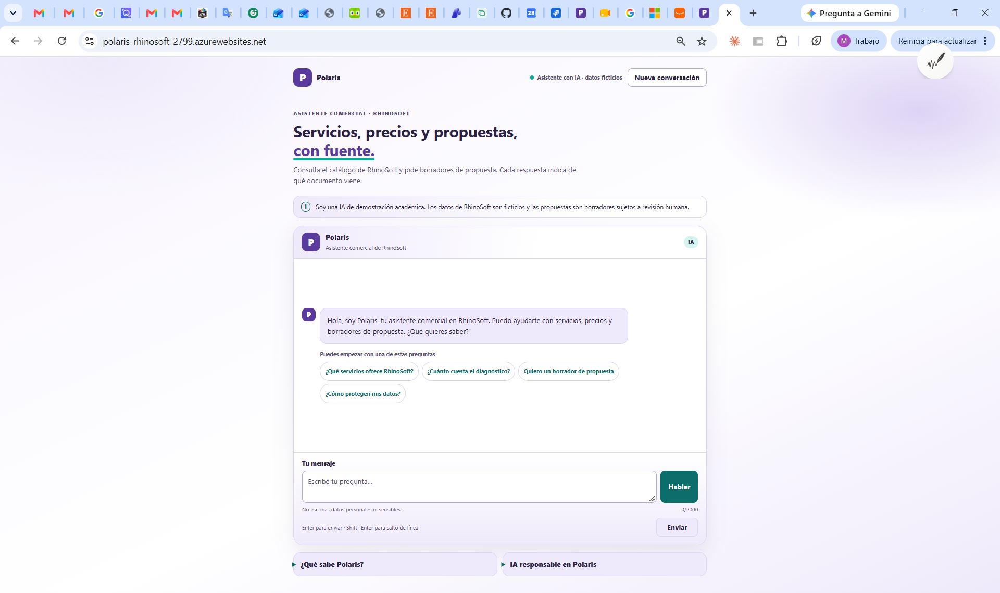

# Polaris · Asistente comercial de RhinoSoft

Asistente web con IA, hecho con **Microsoft Foundry**, **GitHub Copilot** y **Azure App Service**, para el Proyecto Integrador AI-901 (Fase 2, Opción B). Responde sobre servicios, precios y propuestas de RhinoSoft **citando la fuente** de cada respuesta.

> RhinoSoft es una empresa **ficticia** del ejercicio académico. Servicios, precios y condiciones son supuestos de demostración.

| | |
|---|---|
| **Prototipo en línea** | https://polaris-rhinosoft-2799.azurewebsites.net |
| **Reporte completo** | [REPORTE.md](REPORTE.md) |
| **Autora** | Nelly Minerva Compañ Barradas (individual) |



## Qué hace
- Responde sobre el catálogo, precios y condiciones usando solo su base de conocimiento, con la fuente de cada respuesta.
- Redacta borradores de propuesta, sujetos a revisión humana.
- Rechaza temas ajenos y bloquea datos personales antes de enviarlos al modelo.
- Se puede usar por texto o voz, desde computadora o celular.

## Cómo está hecho
Navegador → servidor **Node.js 24 + Express** (Azure App Service) → agente `asistente-rhinosoft` de **Microsoft Foundry** (`gpt-5-mini` con búsqueda en archivos). Sin claves en el código: **identidad administrada** con el rol *Foundry User*. El detalle y la evidencia de los seis principios de IA responsable están en [REPORTE.md](REPORTE.md).

## Ejecutarlo localmente
Requisitos: Node.js 24, Azure CLI con sesión iniciada (`az login`) y el agente creado en Foundry.

```bash
npm install
cp .env.example .env     # completar FOUNDRY_PROJECT_ENDPOINT, FOUNDRY_AGENT_NAME y FOUNDRY_MODEL_DEPLOYMENT
npm run dev              # http://localhost:3000
```

## Estructura
- `server.js`: servidor y filtro de datos personales
- `public/`: interfaz
- `conocimiento/`: base de conocimiento (6 documentos Markdown)
- `scripts/create-agent.js`: creación del agente
- `.github/`: instrucciones y agentes de Copilot
- `docs/img/`: capturas del reporte
